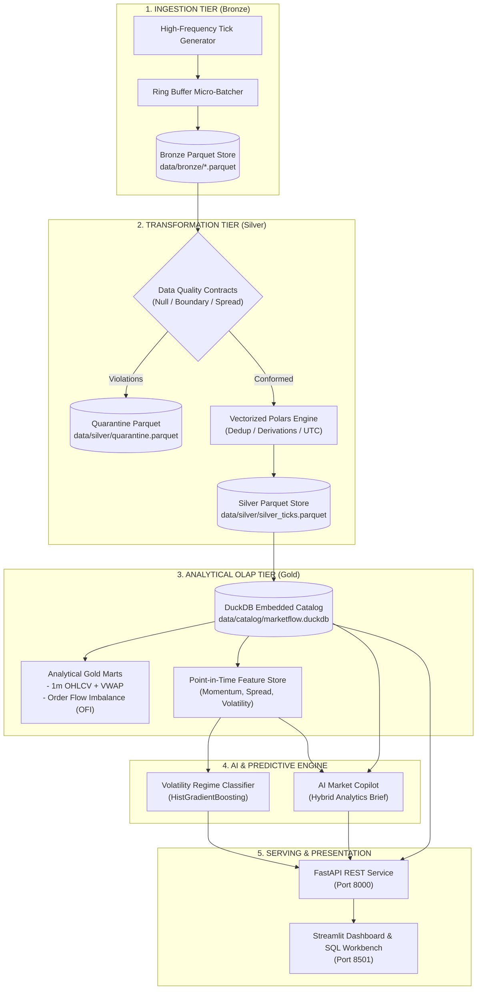

# ⚡ MarketFlow-AI

> **Institutional-Grade Real-Time Market Data Lakehouse & Embedded Predictive AI Engine**  
> *Built with Polars, DuckDB, FastAPI, and Scikit-Learn — Zero JVM bloat, sub-3ms analytical queries, and 2.5M+ events/sec transformation throughput.*

---

[](https://github.com/praveen37x/MarketFlow-AI/actions)
[](https://python.org)
[](https://duckdb.org)
[](https://pola.rs)
[](https://fastapi.tiangolo.com)
[](LICENSE)

---

## 📌 Executive Summary

**MarketFlow-AI** is an end-to-end streaming data lakehouse and AI copilot platform engineered for high-frequency financial market microstructure analytics. It solves the traditional latency and resource footprint bottlenecks of legacy Big Data stacks (Hadoop, JVM Spark) by pairing **Polars** (Rust-backed vectorized processing) with **DuckDB** (embedded in-process vectorized columnar OLAP).

The platform continuously consumes raw market tick streams, validates data against strict contracts in the **Medallion Lakehouse** architecture (Bronze &rarr; Silver &rarr; Gold), extracts point-in-time features into an analytical **Feature Store**, and executes low-latency **Machine Learning inference** and **AI Market Copilot** synthesis in sub-3 milliseconds.

---

## 🏆 Key Architectural Highlights

* **Zero-JVM Architecture**: Replaces heavyweight distributed runtimes with lightweight, embedded columnar engines. Runs anywhere from local developer laptops to edge Kubernetes nodes with minimal RAM.
* **Medallion Data Lakehouse (Bronze &rarr; Silver &rarr; Gold)**:
  * **Bronze Tier**: Immutable, append-only raw micro-batch Parquet partitions.
  * **Silver Tier**: Deduplicated, contract-validated, timezone-normalized records with derived microstructure features (spread, mid-price, dollar volume).
  * **Gold Tier**: High-speed analytical data marts (1-minute OHLCV, VWAP, Order Flow Imbalance) and a point-in-time ML Feature Store.
* **Strict Data Quality Contracts**: Real-time null checking, boundary assertions ($Ask \ge Bid$, $Price > 0$, $Volume \ge 0$), and automated corrupt record quarantining with audit scorecards.
* **Sub-3ms AI Inference**: Embedded Gradient Boosting classifier forecasting short-term market volatility regimes (`LOW_VOLATILITY`, `NORMAL_MARKET`, `HIGH_VOLATILITY_BREAKOUT`) with continuous anomaly scoring.
* **AI Market Copilot**: Hybrid quantitative-textual analyst synthesizing DuckDB Gold mart metrics and market catalysts into actionable trading briefs.
* **Interactive Full-Stack UI**: Integrated Streamlit dashboard with live candlestick price monitoring, Medallion tier telemetry, and an interactive DuckDB SQL query workbench.

---

## ⚡ Verified Performance Benchmarks

*Benchmarked on standard workstation hardware (Python 3.12, 4 worker threads, 50,000 streaming ticks)*:

| Benchmark Dimension | Metric | Performance |
| :--- | :--- | :--- |
| **Ingestion & Micro-Batching** | Ingestion into Ring Buffer & Parquet | **147,773 events / sec** |
| **Polars Vectorized Transformation** | Deduplication, Validation & Feature Derivation | **2,559,285 events / sec** |
| **DuckDB Multi-Symbol Aggregation** | 50,000+ records analytical group-by ($p50$) | **2.50 ms** |
| **DuckDB Analytical Query ($p95$)** | 95th-percentile aggregation latency | **3.13 ms** |
| **ML Volatility Regime Inference** | Feature vector evaluation ($p50$) | **2.58 ms** (~386 preds/sec) |
| **Test Suite Execution** | 11 unit & integration tests (`pytest`) | **3.49s** |

---

## 🏛️ System Architecture



---

## 📁 Repository Structure

```text
marketflow-lakehouse/
├── .github/
│   └── workflows/
│       └── ci.yml                 # Automated testing, linting & benchmark CI
├── config/
│   ├── __init__.py
│   └── settings.py                # Environment configuration & path manager
├── data/
│   ├── bronze/                    # Raw append-only partitioned Parquet
│   ├── silver/                    # Cleaned, conformed & validated Parquet
│   ├── gold/                      # 1m OHLCV, Order Flow & Feature Store Parquet
│   └── catalog/                   # Embedded DuckDB database files
├── scripts/
│   ├── seed_data.py               # Historical dataset seeder (6,000+ ticks)
│   └── benchmark.py               # Throughput and latency benchmarking suite
├── src/
│   ├── __init__.py
│   ├── ingestion/
│   │   ├── __init__.py
│   │   ├── buffer.py              # Thread-safe ring buffer micro-batcher
│   │   ├── collectors.py          # Stream collection orchestrator
│   │   └── generator.py           # Geometric Brownian motion tick generator
│   ├── transformation/
│   │   ├── __init__.py
│   │   ├── cleaner.py             # Polars vectorized deduplication & transformation
│   │   └── contracts.py           # Schema enforcement & data quality contracts
│   ├── lakehouse/
│   │   ├── __init__.py
│   │   ├── engine.py              # DuckDB engine connection pool & view manager
│   │   ├── feature_store.py       # Point-in-time feature extraction interface
│   │   └── marts.py               # Analytical Gold marts (OHLCV, VWAP, OFI)
│   ├── ai/
│   │   ├── __init__.py
│   │   ├── model.py               # Volatility regime ML classifier & anomaly scoring
│   │   └── sentiment_agent.py     # AI Copilot market intelligence synthesis
│   ├── api/
│   │   ├── __init__.py
│   │   ├── main.py                # Production FastAPI service with endpoints
│   │   └── schemas.py             # Pydantic v2 response & request validation models
│   └── dashboard/
│       └── app.py                 # Streamlit interactive UI & DuckDB SQL workbench
├── tests/
│   ├── test_ai_pipeline.py        # ML model prediction & regime validation tests
│   ├── test_api.py                # FastAPI route integration tests
│   ├── test_ingestion.py          # Ingestion generator & buffer unit tests
│   ├── test_lakehouse.py          # DuckDB engine & feature store tests
│   └── test_transformation.py     # Polars cleaner & data quality contract tests
├── Dockerfile                     # Multi-stage production container
├── docker-compose.yml             # Full-stack composition (API + Dashboard)
├── Makefile                       # Developer shortcuts (test, seed, run, bench)
├── pyproject.toml                 # Modern Python packaging & tool configurations
├── requirements.txt               # Pinned dependencies
├── LICENSE                        # MIT License
└── README.md                      # Comprehensive documentation
```

---

## 🚀 Quick Start Guide

### Prerequisites
* **Python 3.9+** (Tested on Python 3.9, 3.10, 3.11, 3.12)
* `pip` package manager

### 1. Clone & Install
```bash
git clone https://github.com/praveen37x/MarketFlow-AI.git
cd MarketFlow-AI
pip install -r requirements.txt
```

### 2. Run Test Suite
Verify all 11 unit and integration tests pass:
```bash
python -m pytest tests -v
# Or: make test
```

### 3. Seed Lakehouse Historical Data
Populate Bronze, Silver, and Gold tiers with 6,000+ realistic ticks across NIFTY, BANKNIFTY, SENSEX, RELIANCE, and HDFCBANK:
```bash
python scripts/seed_data.py
# Or: make seed
```

### 4. Run Performance Benchmark
Execute the automated latency & throughput benchmark:
```bash
python scripts/benchmark.py
# Or: make benchmark
```

---

## 🌐 Running the Services

### Option A: Launch via Python CLI

**1. Start the FastAPI Production Service:**
```bash
uvicorn src.api.main:app --host 0.0.0.0 --port 8000 --reload
```
* **Interactive OpenAPI Swagger Docs**: [http://localhost:8000/docs](http://localhost:8000/docs)
* **Lakehouse Health Telemetry**: [http://localhost:8000/api/v1/health](http://localhost:8000/api/v1/health)

**2. Start the Streamlit Visual Dashboard & SQL Workbench:**
```bash
streamlit run src/dashboard/app.py
```
* **Dashboard URL**: [http://localhost:8501](http://localhost:8501)

### Option B: 1-Command Docker Deployment
```bash
docker compose up --build -d
```
Spins up both the FastAPI backend (`:8000`) and the Streamlit workstation (`:8501`) inside isolated production containers.

---

## 📡 REST API Reference

| Method | Endpoint | Description |
| :--- | :--- | :--- |
| `GET` | `/` | Service meta, status, and API documentation links |
| `GET` | `/api/v1/health` | Lakehouse health check, partition counts & storage stats |
| `POST`| `/api/v1/ingest/trigger` | Ingest micro-batch on-demand & trigger Silver/Gold refresh |
| `GET` | `/api/v1/market/ticks?symbol=NIFTY` | Retrieve latest streaming market ticks with spreads |
| `GET` | `/api/v1/analytics/ohlcv?symbol=NIFTY` | Fetch 1-minute OHLCV candlestick bars with VWAP |
| `GET` | `/api/v1/analytics/features?symbol=NIFTY`| Real-time point-in-time Feature Store vector |
| `GET` | `/api/v1/ai/predict?symbol=NIFTY` | Real-time ML volatility regime & anomaly classification |
| `GET` | `/api/v1/ai/copilot?symbol=NIFTY` | Comprehensive AI Market Analyst brief with trade signals |

---

## 👤 Author & Professional Profile

* **Architect & Developer**: Praveen Tripathi
* **Target Roles**: Senior / Lead AI Developer & Data Engineer
* **Core Competencies**: Modern Lakehouse Architecture, Real-Time Streaming ETL, Polars / DuckDB Optimization, High-Performance REST APIs (FastAPI), MLOps & Production Feature Stores.

---

## 📄 License

This project is licensed under the [MIT License](LICENSE).
